  <picture>
    <source media="(prefers-color-scheme: dark)" srcset="assets/banner-dark.svg" />
    <source media="(prefers-color-scheme: light)" srcset="assets/banner-light.svg" />
    
  </picture>

  

<b>Historian × AI builder.</b> I study Ming dynasty political economy by day, and build multi-agent AI tools by night — for creative writing, training systems, and historical simulation.

  <picture>
    <source media="(prefers-color-scheme: dark)" srcset="https://skillicons.dev/icons?i=py%2Cts%2Cjs%2Celectron%2Cvue%2Creact%2Cnextjs%2Cfastapi%2Cprisma%2Csqlite%2Cthreejs%2Cvite&theme=dark" />
    <source media="(prefers-color-scheme: light)" srcset="https://skillicons.dev/icons?i=py%2Cts%2Cjs%2Celectron%2Cvue%2Creact%2Cnextjs%2Cfastapi%2Cprisma%2Csqlite%2Cthreejs%2Cvite&theme=light" />
    
  </picture>

---

## About

<table>
<tr>
    <th width="50%" align="left">🏛️ Historian</th>
    <th width="50%" align="left">🤖 Builder</th>
</tr>
<tr>
<td valign="top">
Professor & Dean, Institute of Asian Civilizations, Northeast Normal University. PhD in History, University of Alberta.

My research centers on Ming-Qing institutional history — most notably the **"Imperial Agrarian-Commercial Society"** framework for understanding Ming political economy, and a critique of the **"Great Convergence"** narrative in Chinese economic history. I serve as Executive Editor of *Journal of Ancient Civilizations* (《古代文明》) and as a special advisor to the Chinese Ming History Society.

</td>
<td valign="top">
No formal CS background — I came to programming to solve real problems in publishing, training, and business operations, and kept going. Current and past projects include:

- **NovelForge** — a multi-agent AI pipeline for historical novel writing, with a five-layer memory architecture
- **[CourtSim](https://github.com/chrislitality-svg/courtsim)** — a multi-agent simulation engine modeling Ming dynasty court politics
- **Pylo (拍乐)** — an AI-assisted short-drama creation tool for Chinese content creators
- **Haibei Video Engine** — high-volume, template-driven video generation for e-commerce
- Smaller side projects: a [CS2 tactics assistant](https://github.com/chrislitality-svg/cs2-lineups), a [Tetris mod](https://github.com/chrislitality-svg/tetris-widget), and whatever problem is in front of me that week

Outside academia, I run a live-streaming e-commerce company and serve as Training Director at a tech company, where I lead AI adoption initiatives — moving teams from scattered, ad-hoc AI tool use toward end-to-end workflow redesign and codified SOPs.

</td>
</tr>
</table>

## Currently

- Leading a company-wide AI transformation initiative (through August 2026)
- Turning years of Ming dynasty research into a historical novel
- Based in China, currently traveling in Europe

---

## Featured Projects

<table>
<tr>
    <td width="50%" align="center" valign="top"></td>
    <td width="50%" align="center" valign="top"></td>
</tr>
<tr>
    <td width="50%" align="center" valign="top"></td>
    <td width="50%" align="center" valign="top"></td>
</tr>
<tr>
    <td width="50%" align="center" valign="top"></td>
    <td width="50%" align="center" valign="top"></td>
</tr>
</table>

## Project Catalog

Everything I keep public, grouped by theme.

<b>🗣️ Expression-Analysis Agent Skills</b> · 5 repos

Corpus-based Claude Code skills that decompose how specific Chinese speakers structure an argument — each ships a zero-dependency "AI-flavor" detector.

| Repo | What it does | Stack |
|---|---|---|
| [think-like-fandeng](https://github.com/chrislitality-svg/think-like-fandeng) | 樊登-style book-talk skill distilled from ~30 h of corpus (786 coded units) — analysis, narration, dialogue and revision modes | Markdown skill · Python · CI |
| [think-like-wangziru](https://github.com/chrislitality-svg/think-like-wangziru) | Edition 2 of the 王自如 skill, built on 32 transcripts (~860k-char corpus base); one line gets you analysis, drafting, dialogue or revision — answer first, reasons clear, survives follow-up questions | Markdown skill · Python · CI |
| [wangziru-analysis-skill-v1](https://github.com/chrislitality-svg/wangziru-analysis-skill-v1) | Edition 1 (v1.0–v1.3) — the original, more general-purpose recipe, kept as a stable archive | Markdown skill · Python |
| [wangziru-analysis-skill](https://github.com/chrislitality-svg/wangziru-analysis-skill) | The original 王自如 repo, frozen at v1.4; development moved to the two repos above | Markdown skill · Python |
| [luoyonghao-analysis-skill](https://github.com/chrislitality-svg/luoyonghao-analysis-skill) | Unofficial 罗永浩 expression analysis — logic-first decomposition and writing for speeches, benchmarked on 310k characters of corpus | Markdown skill · Python |

<b>📚 Content &amp; Reading Tools</b> · 2 repos

| Repo | What it does | Stack |
|---|---|---|
| [script-to-video](https://github.com/chrislitality-svg/script-to-video) | Turns any document into a 3:4 vertical explainer short, rendered entirely by code — deterministic timeline, reproducible frame by frame | Claude skill · Python · Playwright · ffmpeg |
| [novel-insight](https://github.com/chrislitality-svg/novel-insight) | Local, bring-your-own-LLM analyzer for Chinese web novels — chapter-level mining of character conduct and dialogue tactics into a card knowledge base | FastAPI · Vue 3 · SQLite |

<b>🏯 Historical Simulation</b> · 1 repo

| Repo | What it does | Stack |
|---|---|---|
| [courtsim](https://github.com/chrislitality-svg/courtsim) | Court-politics simulation across seven dynasties, Qin through Qing — LLM-driven debates on real agenda items, grounded in a historical-source RAG corpus; fully local, BYO-LLM | Next.js · TypeScript · Prisma |

<b>🎮 Desktop Widgets &amp; Games</b> · 3 repos

| Repo | What it does | Stack |
|---|---|---|
| [tetris-widget](https://github.com/chrislitality-svg/tetris-widget) | Frameless, always-on-top pixel Tetris — full SRS handling, heuristic-AI battle royale, and a boss key that disguises it as VS Code | Electron · JavaScript |
| [PixelPal](https://github.com/chrislitality-svg/PixelPal) | Pixel-art desktop pet with FSM + behavior-tree AI — 11 species, 90+ job dispatches, a collection book and weather awareness | Electron · TypeScript |
| [forced-reminder](https://github.com/chrislitality-svg/forced-reminder) | A periodic reminder that refuses to be dismissed — modal popups, absolute-timestamp catch-up after reboots, Excel export; Windows 7–11 | Python · PyQt5 |

<b>🌐 Web Tools</b> · 3 repos

| Repo | What it does | Stack |
|---|---|---|
| [cs2-lineups](https://github.com/chrislitality-svg/cs2-lineups) | CS2 lineup sandbox — 3D grenade paths over 11 map overviews, offline PWA, plus portal/rental pages and a small self-hosted sync service | JavaScript · three.js · Python |
| [cs2-portal](https://github.com/chrislitality-svg/cs2-portal) | Single-file, zero-dependency CS2 news page fed by the public Steam API, with built-in fallback data | HTML · JavaScript |
| [engineer-buddy](https://github.com/chrislitality-svg/engineer-buddy) | Conversational requirements clarification — role-based staged interviews that turn vague ideas into OpenSpec proposal packages; ships a key-hiding proxy with rate limits and spend fuses | React · TypeScript · Vite |

<b>📡 Live-Streaming E-Commerce</b> · 1 repo

| Repo | What it does | Stack |
|---|---|---|
| [livestream-coach-oss](https://github.com/chrislitality-svg/livestream-coach-oss) | Sales-talk analysis agent for livestreams — unattended capture → local CPU transcription → quantified talk structure → gap-finding against category benchmarks; rule layer runs at zero model cost | Python · Playwright · sherpa-onnx |

---

## Stats

  
  

  

## Contribution Snake

  <picture>
    <source media="(prefers-color-scheme: dark)" srcset="https://raw.githubusercontent.com/chrislitality-svg/chrislitality-svg/output/github-snake-dark.svg" />
    <source media="(prefers-color-scheme: light)" srcset="https://raw.githubusercontent.com/chrislitality-svg/chrislitality-svg/output/github-snake.svg" />
    
  </picture>

---

  

📖 History, one archive at a time · 🤖 AI, one pipeline at a time

